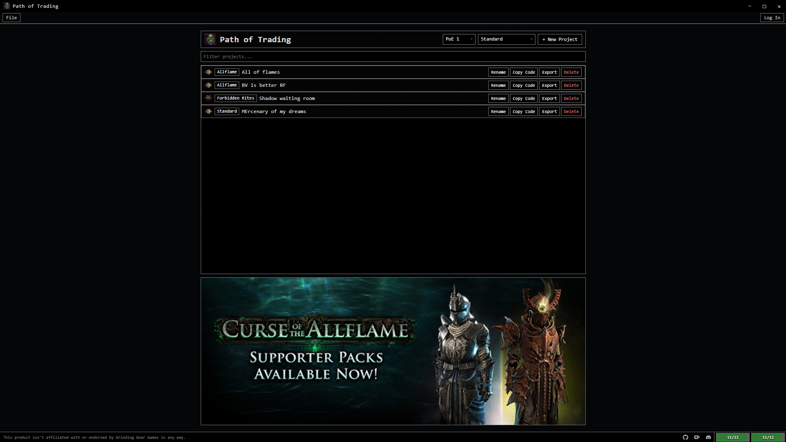
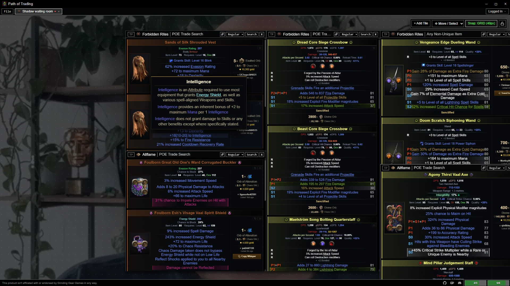

<h1>
  
  Path of Trading
</h1>

**Path of Trading** is Trade manager for [Path of Exile](https://www.pathofexile.com/).

  

  

## Features

- rate-limiter that stops u from breaking rate limits
  - part of rate-limit is reserved for usage outside of the app
- converting currency values
- 'mixed' search
  - regular search, locallyt sorted based on exchange value
  - updated on the go by items coming from live search
- hide bonded modifiers
  - if fox idol, shows bonded that come from idols (probabyl bugged with non-en langs)
- u can tell apart fractured from crafted + fractured
- poe2 tooltip
- global tp-to-hidoeout button
  - can focus only on 1 search
  - always goes top-bottom
- preset blocks for stat groups
- share projects via code
- auto-ignores "are u sure u want to telport to hidoeout? some bot has alreay snipped it so dont waste your time" when trying to teleport to hideout to buy an item

## Download / Install

- [Latest Release Page](https://gitlab.com/aurecueil/pathoftrading/-/releases/permalink/latest)
- [Click Here to Download setup.exe](https://gitlab.com/api/v4/projects/88416718/packages/generic/path-of-trading/v0.5.0/Path-of-Trading_0.5.0_x64-setup.exe)

## Updates

Haphazardous, to improve, should (i hope) work

## Usage

uhhh future me will do this

# Acknowledgments

- _[RePoE](https://github.com/brather1ng/RePoE)_

## Third-Party Notice

This product isn't affiliated with or endorsed by Grinding Gear Games in any way.
The app icon (Pot of Greed) is the intellectual property of Konami and/or its respective rights holders; all rights are reserved by them.
